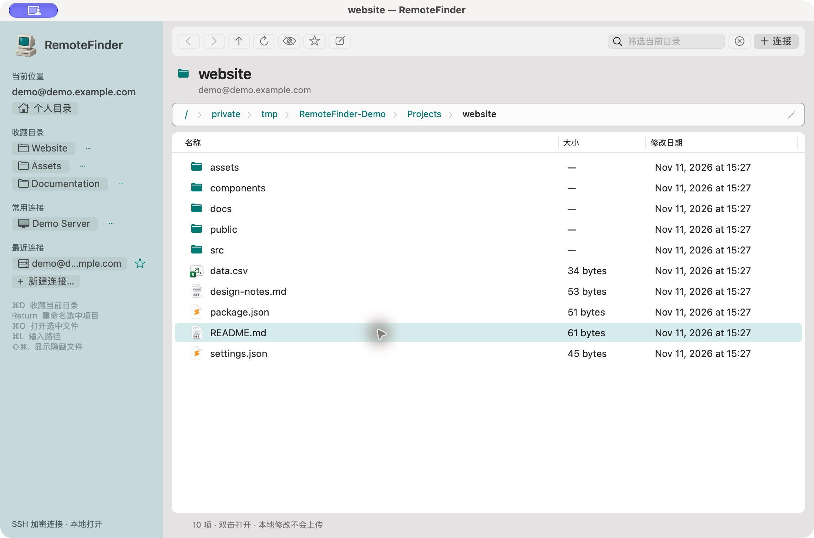

# RemoteFinder


一个轻量的 macOS 原生 SFTP 文件浏览器。Swift + AppKit，无第三方运行时依赖。



*实际运行界面，使用本地 SFTP 演示数据；连接名称和文件均为示例。*

## 下载与安装

**[下载最新 macOS 安装包](https://github.com/chansigit/remotefinder/releases/latest)** · **[安装与权限指南](docs/INSTALL.md)**

下载 `RemoteFinder-版本号-macOS-universal.dmg`，打开后将应用拖到 `Applications`，再从「应用程序」启动。支持 macOS 11+，同一个安装包包含 Apple Silicon 和 Intel 两种架构；无需安装开发工具。另有 ZIP 备用包。

当前版本尚未进行 Developer ID 签名和 Apple 公证。如果首次打开被系统拦截，请先确认下载来源，再按[首次启动说明](docs/INSTALL.md)操作。正常使用无需开启完整磁盘访问、辅助功能或屏幕录制权限。

## 从源码构建

```sh
git clone https://github.com/chansigit/remotefinder.git
cd remotefinder
bash scripts/build.sh
open dist/RemoteFinder.app
```

构建产物：`dist/RemoteFinder.app`。可以复制到“应用程序”目录。需要 macOS 11+ 和 Apple Command Line Tools；构建脚本直接使用 `swiftc`，不要求完整 Xcode。只生成当前 Mac 架构的本地签名应用，尚未进行 Developer ID 签名或公证。

如果项目位于 iCloud / 文件同步目录，建议直接构建到个人应用目录，避免同步服务附加 Finder 元数据影响签名：

```sh
bash scripts/build.sh "$HOME/Applications/RemoteFinder.app"
open "$HOME/Applications/RemoteFinder.app"
```

## 使用

1. 按 **⌘K** 新建连接，可填写易记的连接名称。服务器填写主机名或 `~/.ssh/config` 中的 Host 别名，用户名单独填写。用户名和端口留空时继承 SSH 配置。选择“保存并连接”或“仅保存”；常用连接不依赖登录成功就能保存。输入密码时勾选“保存密码到 macOS 钥匙串”，下次连接可自动使用。
2. 起始目录默认 `.`（服务器的个人目录），也可填写绝对路径或 `~/目录`。
3. 双击文件夹进入；双击文件下载到本地并用系统默认应用打开。支持的 UTF-8 文本保存后会自动同步，其他文件只在本地打开。支持指向目录和文件的符号链接。
4. 使用前进、后退、上一级按钮，或点击地址栏各级目录导航；长路径的祖先目录收在 **…** 菜单里。点击末尾空白或按 **⌘L** 编辑完整路径，Return 跳转，Esc 或点击别处取消编辑。支持绝对路径、相对路径和 `~/`。使用 **⌘R** 刷新。搜索框只筛选当前目录；**⇧⌘.** 显示隐藏文件。点击列表标题排序。
5. 工具栏的叉圈取消当前操作并断开连接。窗口使用不透明的标准 macOS 标题栏，左上角保留原生关闭、最小化和缩放按钮。最近十个成功连接保存在侧边栏；点击最近连接旁的星号可命名并保存为“常用连接”。常用连接旁的 **…** 可编辑名称、服务器、端口和起始目录，或移除保存的连接。
6. 点击工具栏 **☆** 或按 **⌘D**，为当前目录起名并收藏。收藏会保存服务器和完整路径，重启后仍保留；点击侧边栏收藏即可打开，跨服务器时自动切换连接。收藏旁的 **…** 可重命名或移除收藏，不改变远程文件。
7. 选中文件或目录后按 **Return**、点击工具栏重命名按钮，或使用右键菜单，修改远程名称。**⌘O / ⌘↓** 或双击打开项目。已有同名项目时拒绝重命名；成功后刷新列表，并更新同一连接下指向该目录或其子目录的收藏。
8. 将远程文件或文件夹拖到 Finder 文件夹或桌面，松手后后台下载；支持 ⌘ / ⇧ 多选。文件夹包含子目录、隐藏文件和空目录，底部显示整体字节进度，点击可打开传输面板。拖出的文本是独立副本，修改它不会回传远程。

界面采用 Windows 98 桌面青绿与暖灰色系、紧凑的现代布局和圆角；侧边栏保留克制的系统原生毛玻璃效果，尊重系统降低透明度设置。按钮提供悬停提示，说明功能和快捷键。应用图标采用“我的电脑”的 CRT 显示器与主机造型，源图为 `Assets/RemoteFinder.png`，macOS 图标为 `Assets/RemoteFinder.icns`；生成提示词保存在 `Assets/logo-prompt.txt`。

认证交给 `/usr/bin/ssh`：沿用 SSH 配置（包括 ProxyJump）、密钥和 agent；通过原生输入框输入密码、私钥口令及 keyboard-interactive 验证码。Duo 等交互式认证的提示来自服务器；实际兼容性需在目标服务器验证。新服务器会要求确认指纹，指纹变更会拒绝连接。密码可以选择保存在本机 macOS 钥匙串，不写入连接配置、明文文件或日志，也不同步到 iCloud。按服务器、用户名、端口和认证提示隔离；不同目录复用同一连接的密码。不读取或导入 ForkLift 的密码。

在“文件 → 忘记连接密码…”删除当前连接（未连接时为最近连接）的已保存密码，也可从常用连接的 `…` 菜单忘记指定连接的密码。验证码、Duo 选项和私钥口令不保存；识别标准 SSH 密码提示、`Password:` / `Password for 用户:` / `Enter password:`，以及 OpenSSH 添加的 `(用户@主机)` 前缀，其他提示仍需手动输入。取消输入不会改动已保存密码；重新输入时不勾选保存，会删除该提示原有的已保存密码。

## 行为与边界

- 支持浏览、下载、拖放上传、UTF-8 文本本地编辑自动回传，以及**远程重命名**；不提供远程删除。重命名会改变服务器路径，外部脚本或链接需要自行调整。
- 一次连接一个服务器，使用持久 SFTP 会话。网络与磁盘任务在后台串行队列运行；文件下载保留最多 16 个并发读取请求。下载时仍可操作窗口或取消，但其他远程操作等待下载完成。
- 目录缓存按最近使用顺序淘汰，最多 32 个目录、估算 32 MiB；15 秒内返回已访问目录可直接显示缓存，缓存命中不会延长数据新鲜期。刷新强制重新读取。不递归扫描子目录、不读取远程缩略图。
- 大目录的筛选与排序在独立后台队列处理，输入合并延迟 120 ms；新请求会取消过期计算，旧结果不会覆盖当前目录。排序和筛选保留按文件名识别的选中项目。
- 单个目录最多加载 20 万项、估算 64 MiB；超过上限会提示直接打开更具体的子目录，避免异常服务器无限返回目录数据耗尽内存。
- 文件先写临时文件，完成后再移动到最终缓存路径；下载失败会清理不完整文件。校验下载前后的大小和修改时间，但不能保证正在并发写入的文件是原子快照。
- 非文本下载副本位于 `~/Library/Caches/RemoteFinder/`。自动同步文本的工作副本持久保存在 `~/Library/Application Support/RemoteFinder/Editing/`；上传快照和任务记录位于同级 `Transfers/`。不会自动清理编辑副本，以免丢失本地修改。再次打开正在编辑的同一路径会复用工作副本。
- 下载文件附带 macOS quarantine 标记，保留系统对可执行文件的安全检查。
- SSH 空闲时每 15 秒发送保活，最多容忍 6 次未响应；SFTP 单次数据包等待最多 90 秒，给短暂丢包和网络切换留出恢复时间。手动认证最多等待 180 秒，后台重连握手最多等待 30 秒，取消仍会立即中断等待。
- 空闲连接失效会自动检测，按 1、2、4、8、16 秒间隔最多重连 5 次。保留当前目录和浏览历史，恢复后刷新目录；失败的目录读取、链接查询或下载自动重试一次。下载从头重试并清理残留临时文件，暂不支持断点续传。
- 后台重连使用密钥 / SSH agent 或钥匙串中的已保存密码，严格验证已知主机，不弹出密码或验证码窗口。已保存密码参与认证后仍未连接成功，会停止自动尝试，避免重复提交导致账号锁定；服务器要求验证码时仍需手动完成认证。重连失败后点击刷新（⌘R）或侧边栏连接，手动完成认证。主动断开、切换服务器或退出会取消重连。
- 重命名不会自动重放；若执行途中断线，会提示结果未确认，恢复后请检查目录。普通目录权限错误不重试，也不会主动断开仍可用的会话。保活无法绕过服务器的最长会话时间或认证策略。
- 当前支持 SFTP v3 和 UTF-8 文件名。不支持 FTP、WebDAV、Finder 挂载、双栏同步或下载断点续传。

## 拖放传输和本地编辑同步

- 拖出下载采用 macOS 原生文件承诺（file promise），以 Finder 提供的目标名称和位置为准，不直接覆盖同名文件。下载使用后台传输队列及独立于浏览的 SFTP 连接；先写入目标文件夹内的隐藏临时副本，全部成功后才提交文件或整棵目录。文件和目录带有 macOS 下载安全标记。
- 递归下载会先统计完整目录，再下载内容，总进度按字节计算。暂不跟随或复制符号链接、设备等特殊文件；遇到这些项目会明确报错并取消整项下载，避免循环和无提示的内容缺失。单次上限为 20 万项、128 层目录及约 64 MiB 路径记录；超出时请分批拖出子目录。远程目录不是快照，下载期间请避免改动它。
- 下载失败、取消或退出后需重新拖出，不支持下载断点续传；「停止任务」可以取消当前下载。正常失败会清理临时副本，强制结束进程时可能留下目标目录下的隐藏 `.partial` 文件。下载记录不会启用本地编辑监听，也不能误用上传/覆盖远程操作。
- 把 Finder 的一个或多个普通文件拖到文件列表空白处，上传到当前目录；拖到文件夹行上，上传到该文件夹。拖动时显示目标路径，也可用「文件 → 上传文件…」（⌘U）。不递归上传文件夹，不上传符号链接。
- 双击支持的 UTF-8 文本（最多 5 MiB）会用系统关联的本地应用打开，保存后自动回传。支持常见代码、配置、Markdown、CSV 等文本；PDF、图片、二进制和其他编码仅本地打开。最多同时监听 20 个文件。
- 上传和文本同步默认在后台运行，不自动弹出面板。窗口底部显示当前阶段的百分比和进度条；点击进度条、「传输与编辑」按钮或 ⌘J 查看进度、本地副本、重试 / 续传、重新上传、保留两份、覆盖远程、重新加载和停止同步。重新加载会先在工作副本旁保存 backup 文件。另存到其他路径不会关联上传；关闭编辑器不停止监听。退出 RemoteFinder 期间不上传，重启后恢复监听；未完成的上传先暂停，点击重试才续传。
- 上传使用独立 SFTP 连接与串行队列，不占用目录浏览连接。每次上传先固定本地快照；编辑过程中继续保存会在当前版本完成后再同步最新内容。网络失败最多自动尝试 5 次，账号认证需要交互时可手动重试。
- 远程数据先写入同目录的 `.remotefinder-UUID.partial`，断线保留临时文件。续传前校验完整已传前缀，完成后校验 SHA-256 内容；丢失提交回执时核实目标内容，避免盲目覆盖。上传与校验最多保留 16 个在途请求，校验支持乱序和短读；临时文件完整校验后，原子提交收到成功确认即可完成，不再重复读回整份目标文件。校验仍会读回远程数据，因此会增加带宽和时间。界面分别显示上传、续传校验、内容校验和提交阶段；校验 100% 不代表已经提交成功。临时文件被服务器清理时从头上传，校验不一致时需选择重新上传。
- 同名上传及远程内容变化都会暂停并提示冲突。覆盖使用服务器的 `posix-rename@openssh.com` 扩展；不支持安全替换时只能另存副本，不删除旧文件再上传。保留普通权限位，但原子替换可能改变所有者、ACL、扩展属性和硬链接关系；不用于依赖这些属性的系统文件。SFTP 不提供本方案所需的条件提交锁，最终检查与替换之间仍存在很短的并发修改窗口，不能当作多人协作锁。
- 停止任务会保留本地副本和远程续传文件；「重新上传 / 保留两份」会创建新的临时路径，旧的隐藏 partial 文件可能需要手动清理。任务记录不包含密码。

## 验证

```sh
bash scripts/test.sh
```

测试使用本机 `/usr/libexec/sftp-server` 和一个 Python 标准库测试服务，不连接外部服务器。覆盖参数校验、二进制协议解析、1,207 个目录项、中文/空格/换行/特殊字符文件名、符号链接、2 MiB 下载内容比对、空文件、错误恢复、取消阻塞、短读及乱序下载响应，以及收藏持久化、收藏改名、目录路径更新、远程文件/目录/符号链接重命名和同名保护。路径栏另有交互检查，覆盖空白点击命中、逐级路径、长路径折叠、编辑提交、Esc 取消、失焦取消和忙碌时禁用。另有 10 万条目录项的后台筛选/排序与主线程响应测试、缓存淘汰/过期测试，以及断线、超时、畸形响应、目录加载上限和强制回收卡住子进程的故障测试。连接恢复测试还覆盖空闲断线、目录读取重试、重试次数上限、重命名不重放，以及断开和切换服务器后取消旧重连任务。密码测试使用临时合成凭据，验证真实钥匙串的保存、更新、读取、删除和连接隔离，以及实际 askpass 分支的密码复用、失败后不重复提交、后台认证不弹窗；不读取用户真实密码。

拖出测试验证原生 `NSFilePromiseProvider` 剪贴板数据可被 `NSFilePromiseReceiver` 识别，并在后台调用文件承诺回调，通过本地 SFTP 服务验证文件与文件夹交付，覆盖切换目录/断开浏览后保留来源、后台进度、递归内容比对、空目录和隐藏文件、同名保护、取消清理及符号链接循环拒绝。自动化测试不替代 Finder 跨窗口拖动手势检查。

协议参考：[SFTP v3 规范草案](https://www.ietf.org/archive/id/draft-ietf-secsh-filexfer-02.txt)，[Apple 文件拖放承诺](https://developer.apple.com/documentation/appkit/supporting-table-view-drag-and-drop-through-file-promises)。SSH 认证由系统 OpenSSH 负责，未自行实现加密协议。

## 构建发布包

发布包可在 macOS 上通过 `bash scripts/release.sh` 构建，输出 Universal DMG、ZIP 和 SHA-256 校验文件到 `dist/releases/`。脚本会编译两个架构并检查签名及磁盘镜像完整性；不会上传文件或执行 Apple 公证。

## 开源许可

本项目采用 [MIT License](LICENSE)。欢迎提交 Issue 和 Pull Request。应用图标由 AI 生成，生成提示词及源图一并保存在 `Assets/`。
